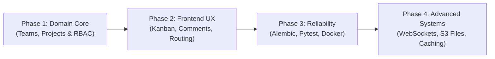

# teamTasks — System Architecture & Future Roadmap

> **Author**: Muna  
> **Course**: System Analysis and Design (SAD) — Year 2, Semester 1  
> **Repository**: `teamTasks` (FastAPI + PostgreSQL + React)

---

## 1. System Analysis & Design (SAD) Concept Mapping

This table connects the theoretical concepts taught in your university SAD curriculum to the actual code in this repository:

| SAD Topic | Practical Implementation in `teamTasks` | File Reference |
| :--- | :--- | :--- |
| **3-Tier Architecture** | Client (React Vite) $\rightarrow$ Logic / Application (FastAPI) $\rightarrow$ Database (PostgreSQL) | Entire project structure |
| **Separation of Concerns (SoC)** | Routes (Controllers) $\neq$ Pydantic (Data Transfer Objects) $\neq$ SQLAlchemy (Persistence Models) | `Backend/raw/routes/`, `schemas.py`, `models.py` |
| **Entity-Relationship Modeling (ERD)** | 1-to-many relationships (`Users` $\rightarrow$ `Tasks`, `Tasks` $\rightarrow$ `Comments`, `Tasks` $\rightarrow$ `Attachments`) | `Backend/raw/models.py` |
| **Relational Integrity & Foreign Keys** | `ondelete="CASCADE"` for comments/attachments; `ondelete="SET NULL"` for user deletion | `Backend/raw/models.py` |
| **Functional Requirements (FR)** | User Registration, User Login, Task CRUD, Task Status Transitions, Commenting | `Backend/raw/routes/` |
| **Non-Functional Requirements (NFR)** | Security (Argon2 password hashing, HTTP-only cookies, JWT), Performance (DB indexing on `status`, `assigned_to_user_id`) | `Backend/raw/utils.py`, `models.py` |
| **State Machine Modeling** | Task Lifecycle: `TODO` $\rightarrow$ `IN_PROGRESS` $\rightarrow$ `REVIEW` $\rightarrow$ `DONE` | `Backend/raw/models.py` (`TaskStatus`) |
| **Soft Deletion Pattern** | Using `deleted_at` timestamp instead of destructive physical `DELETE` queries | `Backend/raw/models.py`, `routes/tasks.py` |

---

## 2. Immediate Code & Architectural Fixes (High Priority)

Before adding new features, address these core system design and logic flaws:

### 2.1 Multi-Tenancy & Data Isolation (`Backend/raw/routes/tasks.py`)
- **Current Issue**: `get_all_tasks()` runs `db.query(models.Tasks).filter(models.Tasks.deleted_at.is_(None)).all()`. Any registered user can see all tasks created by all other users.
- **Fix**: Filter tasks by ownership or team membership:
  ```python
  tasks = db.query(models.Tasks).filter(
      (models.Tasks.created_by_user_id == current_user.id) | 
      (models.Tasks.assigned_to_user_id == current_user.id),
      models.Tasks.deleted_at.is_(None)
  ).all()
  ```

### 2.2 Broken Authorization on Task Modification (`Backend/raw/routes/tasks.py`)
- **Current Issue**: `update_one_task()` allows any authenticated user to update any task ID if they know the integer ID.
- **Fix**: Verify `task.created_by_user_id == current_user.id or task.assigned_to_user_id == current_user.id` before committing changes.

### 2.3 Semantic Error in Soft Deletion (`Backend/raw/routes/tasks.py`)
- **Current Issue**: In `delete_task()`, the code sets `task.status = models.TaskStatus.DONE` when deleting.
- **Fix**: Deleting a task is not completing it. Leave the status as-is or set a specific archived state, and only record `task.deleted_at = datetime.now(timezone.utc)`.

### 2.4 Production Cookie Security (`Backend/raw/routes/auth.py`)
- **Current Issue**: `response.set_cookie(..., secure=False, samesite="lax")`.
- **Fix**: For production deployments (Vercel / HTTPS), set `secure=True` and configure environment-based cookie options.

### 2.5 RESTful Cleanliness
- **Current Issue**: `PATCH /tasks/{id}/complete` is an RPC-style action.
- **Fix**: REST typically handles this via `PATCH /tasks/{id}` with `{ "status": "DONE" }`, which is already supported by your `update_one_task` endpoint.

---

## 3. Evolutionary Roadmap



---

### Phase 1: Completing the Domain Model (True "Team" Tasks)

To match the project name `teamTasks`, introduce multi-user collaboration primitives into your ERD:

1. **`organizations` or `teams` Table**:
   - `id`: Integer / UUID (Primary Key)
   - `name`: String
   - `created_at`: Timestamp
2. **`team_members` (Association Table for Many-to-Many with Roles)**:
   - `team_id`: ForeignKey(`teams.id`, ondelete="CASCADE")
   - `user_id`: ForeignKey(`users.id`, ondelete="CASCADE")
   - `role`: Enum (`OWNER`, `ADMIN`, `MEMBER`, `VIEWER`)
3. **`projects` Table**:
   - `id`: Integer
   - `team_id`: ForeignKey(`teams.id`)
   - `name`: String
   - `description`: Text
4. **Update `tasks` Table**:
   - Add `project_id`: ForeignKey(`projects.id`, ondelete="CASCADE")

---

### Phase 2: Frontend & UI/UX Parity

Connect the frontend to the backend features already implemented in Python:

1. **Client-Side Routing**:
   - Install `react-router-dom` to replace manual `authPage` state switching with structured routes (`/`, `/login`, `/signup`, `/board`, `/tasks/:id`).
2. **Task Comments Interface**:
   - Backend routes already exist at `/tasks/{task_id}/comments`.
   - Add a sliding drawer or modal on the task card to list comments and add new replies.
3. **Assignee Picker**:
   - Fetch users via `GET /users/` and allow the task creator to assign a teammate from a dropdown.
4. **Kanban Board Layout**:
   - You already defined `BoardOut` in `schemas.py` with `todo`, `in_progress`, `review`, and `done`.
   - Implement 4 columns on the dashboard with drag-and-drop (using `@hello-pangea/dnd` or HTML drag events).

---

### Phase 3: Engineering Reliability & Testing

1. **Database Migrations with Alembic**:
   - Initialize Alembic in `Backend/` (`alembic init alembic`).
   - Stop dropping tables or manually editing schemas; generate migration scripts for every schema update.
2. **Automated Backend Testing**:
   - Add `pytest` and `httpx` to test endpoints with an in-memory SQLite database or a test PostgreSQL instance.
   - Test cases: Registration conflict, successful login, unauthorized task access, soft-deletion verification.
3. **Containerization (Docker & Docker Compose)**:
   - Create a `Dockerfile` for the FastAPI backend and React frontend.
   - Create a `docker-compose.yml` that spins up PostgreSQL + Backend + Frontend with a single command: `docker compose up --build`.

---

### Phase 4: Advanced System Design Features

1. **File Attachments with Cloud Storage**:
   - Your `models.py` already includes an `Attachments` model (`file_key`, `file_name`, `content_type`, `size_bytes`).
   - Implement presigned upload URLs (using AWS S3 or Cloudflare R2) so the client uploads files directly to cloud storage without overloading the FastAPI server.
2. **Real-Time Synchronization (WebSockets)**:
   - When User A moves a task on the Kanban board, User B sees it update instantly without refreshing.
   - Use FastAPI's native `WebSocket` support or Server-Sent Events (SSE).
3. **Activity Logs & Audit Trail**:
   - Create an `activity_logs` table (`user_id`, `task_id`, `action`, `created_at`) to track changes ("User A changed status from TODO to DONE").
4. **Asynchronous Background Jobs**:
   - Integrate Celery or ARQ with Redis for sending email notifications when tasks are assigned or due dates approach.
